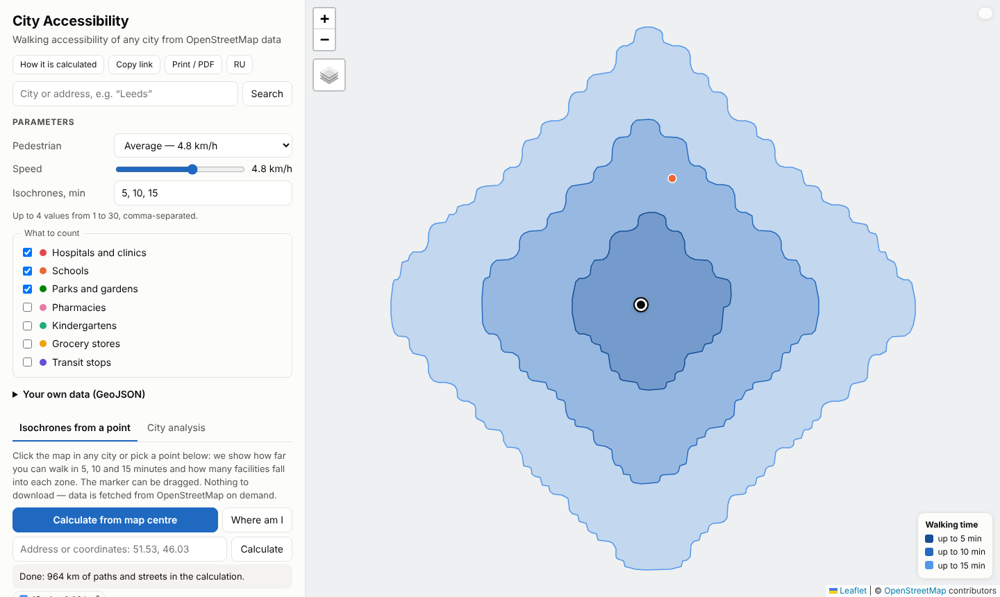
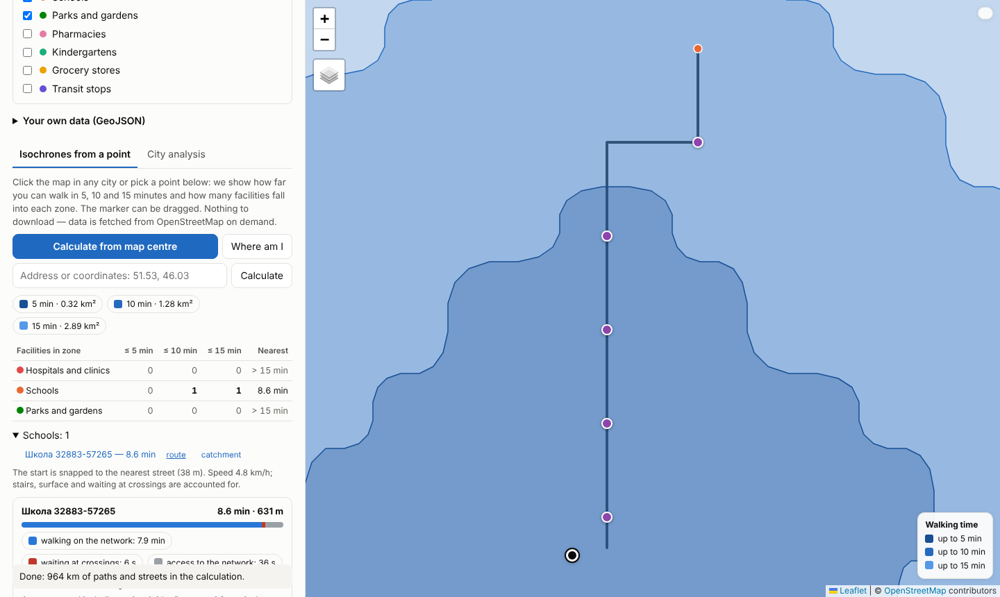
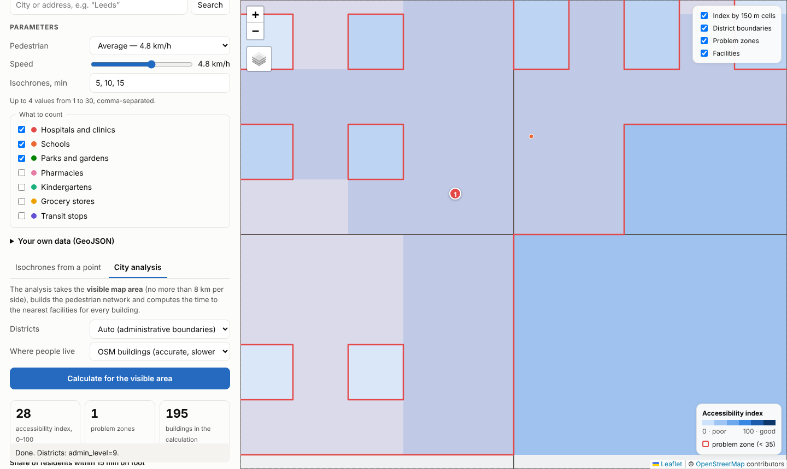
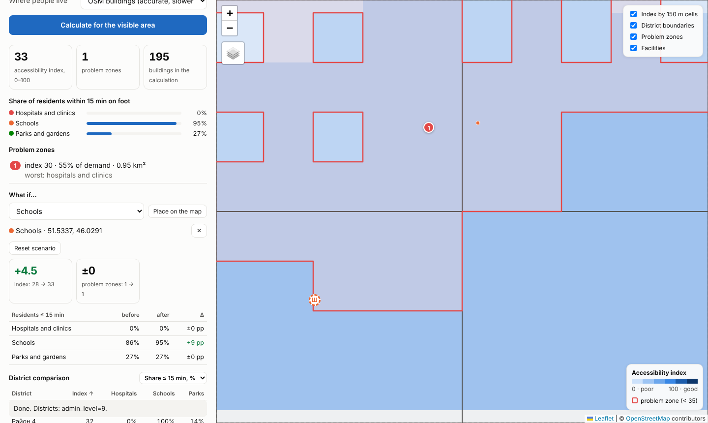
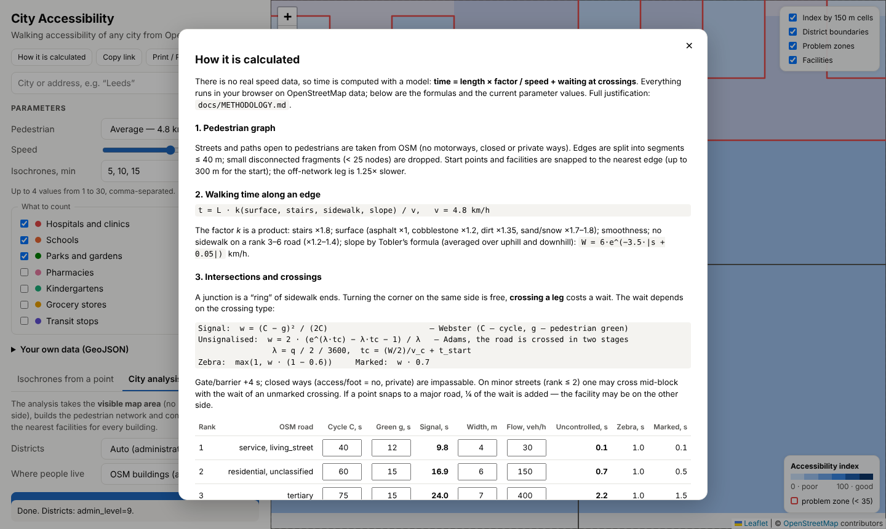

# City Accessibility

[](https://doi.org/10.5281/zenodo.24132875)

A web app for analysing **walking accessibility of urban infrastructure** in any city, built on open [OpenStreetMap](https://www.openstreetmap.org) data. It runs entirely in the browser: no server, API keys or sign-up. The UI is available in English and Russian (RU/EN button in the panel header; `#l=en` in the URL).

**Demo:** https://dmitrylelee.github.io/city_accessibility/ · **Desktop app:** [Releases](https://github.com/DmitryLeLeE/city_accessibility/releases/latest)

Nothing needs to be downloaded to calculate: pick any point on the map and press a button — the data is fetched from OpenStreetMap on demand.

## Features

- **5 / 10 / 15-minute isochrones** from any point (click, map centre, geolocation, address or `lat, lon`, or "catchment" from a facility).
- **Accessibility of hospitals, schools, parks** (plus pharmacies, kindergartens, groceries, transit stops): counts per zone and time to the nearest.
- **Pedestrian network analysis:** travel time accounts for intersections (traffic lights, zebras, uncontrolled crossings, side of the road), surface, stairs, slope, gates and missing sidewalks.
- **Problem-area detection:** 150 m cells with a low index are merged into numbered problem zones.
- **District comparison:** OSM administrative boundaries or square grids; sortable table; CSV and GeoJSON export.
- **Your own data:** upload GeoJSON with custom facilities (points/polygons, a new category) and population (points/polygons with a `pop` property) replacing the building-based estimate. Files never leave the browser.
- **"What if" scenarios:** in area analysis place a hypothetical school, hospital, park… and see the change in index, problem-zone count and resident shares per category.
- **Compare and print:** save calculations in the browser and compare several (city, speed, scenario) in one table / CSV; "Print / PDF" gives a print layout with parameters and date.
- **Route breakdown:** the path to a facility with time split into walking, waiting at crossings and network access; crossings shown on the map.
- **Transparency:** "How it is calculated" dialog with formulas and live parameter tables, an editable model (signal cycles, road widths and flows, crossing speed…), and a calculation log.
- **Shareable links** (state in the URL hash), speed presets (average, elderly, stroller, small child, fast), local tile cache (IndexedDB, 7 days).
- **Resilience:** 5 Overpass mirrors with cool-down for failed ones, timeouts and retry rounds; geocoder Nominatim → Photon fallback.

## Screenshots

> Screenshots are taken on a synthetic city (a perfect street grid, demo data) so they are reproducible offline — `npm run screenshots`. Real cities look the same, with actual OSM streets.

| 5 / 10 / 15-minute isochrones | Route with a breakdown of waits |
|---|---|
|  |  |

| Area analysis: index and problem zones | "What if": a hypothetical school |
|---|---|
|  |  |



## How travel time is computed

```
time = length × path factor (surface, stairs, slope, sidewalk) / speed
     + waiting at crossings (signal, zebra, uncontrolled crossing)
```

- A pedestrian walks on a sidewalk, so the state is *(arc, side of the road)*. Every junction is a ring of sidewalk ends: turning on the same side is free, crossing a leg costs a wait.
- Waits come from traffic-flow theory rather than being tuned: Webster `(C − g)² / (2C)` at signals, Adams `(e^{λt} − λt − 1) / λ` at unsignalised crossings (two-stage crossing).
- Accessibility index: 100 points at ≤ 5 min, 0 at ≥ 20 min, linear in between; weighted by building levels as a population proxy.

Full derivation, assumptions, error estimates and references: [docs/METHODOLOGY.en.md](docs/METHODOLOGY.en.md) ([Russian](docs/METHODOLOGY.md)).

## Run

```bash
git clone https://github.com/DmitryLeLeE/city_accessibility
cd city_accessibility
npm start          # http://localhost:8080
npm test           # 58 unit tests, no network or browser needed
npm run lint       # ESLint
npm run test:e2e   # browser e2e (Playwright, mocked Overpass); needs Chromium or CHROME_PATH
npm run desktop    # desktop window (Electron)
```

Desktop installers (Windows installer and portable, Linux AppImage, macOS dmg) are built by `.github/workflows/release.yml` and attached to [Releases](https://github.com/DmitryLeLeE/city_accessibility/releases). They are unsigned, so Windows SmartScreen / macOS Gatekeeper may warn on first launch.

## Limitations

OpenStreetMap completeness limits accuracy; signal cycles and traffic flows are typical values by road class, not measurements (editable in the app); building levels are a proxy for population, not a census (you can upload your own data); Overpass is a shared free service and may be slow or briefly unavailable (the app switches mirrors automatically).

## How to cite

See [CITATION.cff](CITATION.cff) (GitHub's "Cite this repository" button). Releases are archived on Zenodo — the all-versions DOI is [10.5281/zenodo.24132875](https://doi.org/10.5281/zenodo.24132875) (always resolves to the latest); the DOI of version 1.1.0 is [10.5281/zenodo.24133072](https://doi.org/10.5281/zenodo.24133072).

## Contributing and privacy

[CONTRIBUTING.md](CONTRIBUTING.md), [CHANGELOG.md](CHANGELOG.md), [PRIVACY.md](PRIVACY.md) — which external requests the app makes and what is stored in the browser.

## Data and licences

Data © OpenStreetMap contributors ([ODbL](https://www.openstreetmap.org/copyright)). Map: [Leaflet](https://leafletjs.com); OSM → GeoJSON: [osmtogeojson](https://github.com/tyrasd/osmtogeojson); desktop: [Electron](https://www.electronjs.org). Project code: MIT.
